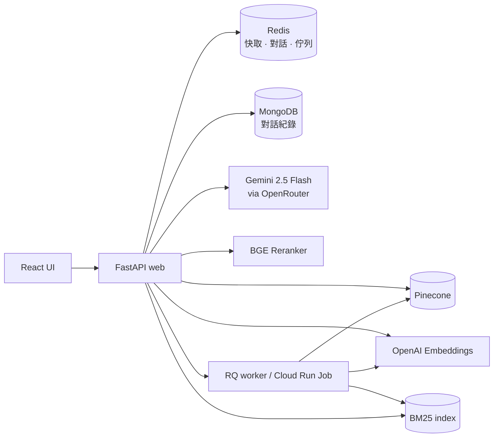

# RAG_DEMO

一個容器化的 Web 應用，內建 Agentic RAG 聊天機器人，兼具碳管理專業知識與通用問答能力。正式介面採 React + TypeScript，FastAPI 提供同源 API 與靜態成品。

---

## 如何啟動專案

### 事前準備

- Docker 與 Docker Compose
- Git

### 1. 環境設定

Clone 專案後，在根目錄建立 `.env` 檔案（完整項目請參考 `.env.example`）：

```
OPENAI_API_KEY="your_openai_api_key_here"
PINECONE_API_KEY="your_pinecone_api_key_here"
OPENROUTER_API_KEY="your_openrouter_api_key_here"

# 存取控制
APP_API_KEY="a_long_random_string_you_choose"   # 共用金鑰，用於 /login 及 X-API-Key
AUTH_ENABLED=true                               # 本機開發/測試可設為 false
```

### 2. 啟動應用程式

```bash
docker compose up --build
```

### 3. 存取服務

- **主應用程式**：[http://localhost:8000](http://localhost:8000)，首次造訪會顯示登入頁，輸入 `APP_API_KEY` 即可登入。
- **Redis 管理介面（RedisInsight）**：[http://localhost:8001](http://localhost:8001)，用於檢視 prompt cache。
- **MongoDB 管理介面（Mongo Express）**：[http://localhost:8081](http://localhost:8081)，用於檢視對話紀錄。

---

## 專案介紹

碳管理（CarbonM）領域的 Agentic RAG 聊天機器人，兼具知識庫問答與通用問答能力。

- **混合路由**：規則層零延遲判斷明確查詢，僅不確定的查詢交給 LLM 決定走 RAG 或直接生成，並同時改寫追問。
- **Hybrid Search**：BM25 關鍵字檢索 + Pinecone 向量檢索，以 RRF 融合後由 BGE Reranker 精排。
- **自省式檢索**：重排分數不足時自動改寫查詢並重試。
- **語意快取**：Redis 攔截相似問題，降低延遲與 token 成本。
- **雙端 Guardrail**：輸入端偵測 prompt injection，輸出端掃描 PII 與注入內容。
- **多輪對話**：保留短期對話脈絡，支援自然追問，可一鍵清除目前對話。
- **Typed NDJSON 串流**：分開傳送狀態、回答、來源與耗時。
- **背景知識庫同步**：上傳 PDF / XLSX / CSV，由背景任務增量同步向量庫與 BM25 索引，介面可查詢工作狀態。
- **可觀測性與評估**：LangSmith 追蹤各階段、MongoDB 保存對話紀錄、RAGAS 離線評估。
- **手機優先 React 介面**：登入、串流聊天、來源展開、文件上傳與深色模式。

---

## 系統架構



Docker Compose 服務：`web`（FastAPI，提供 `/api/v1/*` 與 React 靜態成品）、`worker`（RQ 背景任務）、`redis`、`mongodb`，以及管理介面 `mongo-express`（port 8081）與 `redis-insight`（port 8001）。

請求流程、各階段參數、知識庫同步與評估方式詳見 **[architecture.md](architecture.md)**。

---

## 前端開發與驗證

正式 Docker image 會在 Node build stage 執行前端建置，runtime 只保留 Python 與 `frontend/dist`。需要單獨開發介面時：

```bash
cd frontend
corepack enable
pnpm install --frozen-lockfile
pnpm dev
```

Vite 會把 `/api` 與 `/health` proxy 到 `http://localhost:8000`。前端檢查：

```bash
pnpm lint
pnpm typecheck
pnpm exec vitest run --maxWorkers=1
pnpm build
```

Python source 開發可使用：

```bash
docker compose -f docker-compose.yml -f docker-compose.dev.yml up --build
```

Dev override 只掛載 `src`，不覆蓋 image 內的 `frontend/dist`；Python 修改後重啟 web/worker。前端修改需 Vite dev server 或重新 build image。web/worker 共用 `manual_data` 與 `bm25_data` volumes，讓背景 worker 能讀取已上傳文件、web 會在約 30 秒內自動載入 worker 重建的 BM25 index（`BM25_RELOAD_INTERVAL_SECONDS`）。移除 volumes 會清除這些本機資料。

主要 API：

- `GET /api/v1/auth/session`、`POST /api/v1/auth/login`、`POST /api/v1/auth/logout`：session bootstrap、登入與撤銷。
- `POST /api/v1/chat/stream`：`application/x-ndjson` 串流事件。
- `GET|DELETE /api/v1/conversations/current/messages`：目前 session 的短期對話。
- `POST /api/v1/admin/manuals`、`GET /api/v1/admin/jobs/{job_id}`：上傳手冊與查詢同步狀態。

## Side project 範圍

- 使用共用 `APP_API_KEY`，同一底層 key 共用預設 60 RPM，不含多帳號與 RBAC。
- Redis 對話脈絡閒置 30 分鐘後過期；清除目前對話不會刪除 MongoDB 稽核紀錄、prompt cache 或 LangSmith trace。
- 「停止」會立即停止瀏覽器接收；已在後端完成的回答仍可能完成保存，不保證強制取消模型工作。
- 部署維持單一 Cloud Run instance，尚未宣稱高併發容量；擴大公開使用前需另做壓測與背壓設計。
- 所有登入者皆可使用管理上傳；預設 `MAX_UPLOAD_BYTES=26214400`（25 MB）。上傳包含副檔名/MIME/大小/路徑基本驗證，但不含惡意檔案掃描、RBAC 或完整 PII/DLP 治理。
- 停止接收保留目前顯示的文字並標示未完成；未保存的內容不保證重新整理後存在。已送出的 provider 請求不保證立即停止計費。
- 單程序會以 session 防止重複聊天／清除衝突（409）；不提供跨 instance 鎖。
- 手機中文鍵盤開啟時收起底部分頁與建議問題，輸入區跟隨 VisualViewport；關閉後恢復。主題跟隨系統深淺模式。

## 前端驗收

元件與 parser 測試：`cd frontend && pnpm exec vitest run --maxWorkers=1`。完整驗收證據與尚未完成項目見 `openspec/changes/archive/2026-10-03-replace-gradio-frontend/validation.md`。

瀏覽器驗收腳本 `frontend/e2e/acceptance.mjs` 使用 Playwright 與本機 Chrome，mock API，不會呼叫真實 LLM 或提交真實上傳。先建置前端，再從 `frontend/dist` 啟動本機靜態 server（預設 `http://127.0.0.1:18173`）。在有 Playwright 的環境執行 `node frontend/e2e/acceptance.mjs`；也可用 `PLAYWRIGHT_MODULE_PATH` 指向現有 Playwright 的 `index.mjs`。`ACCEPTANCE_URL` 可指定測試 URL，`ACCEPTANCE_OUTPUT` 可指定截圖目錄。

Docker smoke test 使用 image 內的 Python 與 fake chat/job provider：

```bash
docker build -t rag-react-acceptance .
docker run --rm --mount type=bind,source="$PWD/scripts/frontend_docker_smoke.py",target=/tmp/frontend_docker_smoke.py,readonly rag-react-acceptance python /tmp/frontend_docker_smoke.py
```

`frontend/e2e/socket-acceptance.mjs` 可對 `scripts/phone_acceptance.py` 的隔離同源測試站執行真實 HTTP cookie/history/abort/upload 流程（fake provider/job、記憶體資料）。指定 `ACCEPTANCE_URL` 與相同 Playwright 路徑即可重跑；測試站登入 key 僅供測試使用，不能部署為正式服務。

`scripts/real_rag_smoke.py` 提供需明確授權的真實 provider 單人／兩人測試。授權前不執行；caller 私下提供 credentials，設 `ALLOW_LIVE_RAG_SMOKE=true`，不把 key 寫入命令、log 或 commit。腳本停用 cache、tracing 與 history/Mongo 寫入，僅輸出耗時、回答長度與來源數。

這些自動化測試不取代實際手機虛擬鍵盤、真實 provider 容量或正式 Cloud Run revision 的切換與 rollback 驗收。

## 部署

一般版本的發布流程與每版紀錄見 [發布紀錄](docs/deployment/releases.md)；React 切換時的完整手冊見 [部署手冊](docs/deployment/replace-gradio-frontend.md)。正式環境使用 React SPA 與 `JOB_RUNNER=gcp`，web 與 sync job 共用 GCS 掛載的 `DATA_SOURCE_DIR`/`BM25_INDEX_DIR`；模型快取 `MODEL_CACHE_DIR` 保留 image 內路徑。`GCP_PROJECT_ID`、`GCP_REGION`、`SYNC_JOB_NAME` 指定背景 job。

其他環境變數與預設值見 `.env.example`，包括 `RATE_LIMIT_RPM`、`SESSION_TTL_SECONDS`、`CHAT_HISTORY_TTL_SECONDS`、`CHAT_HISTORY_MAX_TURNS`。正式部署必須設定共用登入 key；HttpOnly session cookie 在 HTTPS 下使用 Secure，變更 API 使用同源 Origin/Referer 驗證。

React 已於 2026-10-03 正式上線，實體手機驗收完成。新程式不再包含 Gradio；舊 Cloud Run revision/image 保留供回復，無須在新版本重新啟用舊介面。
