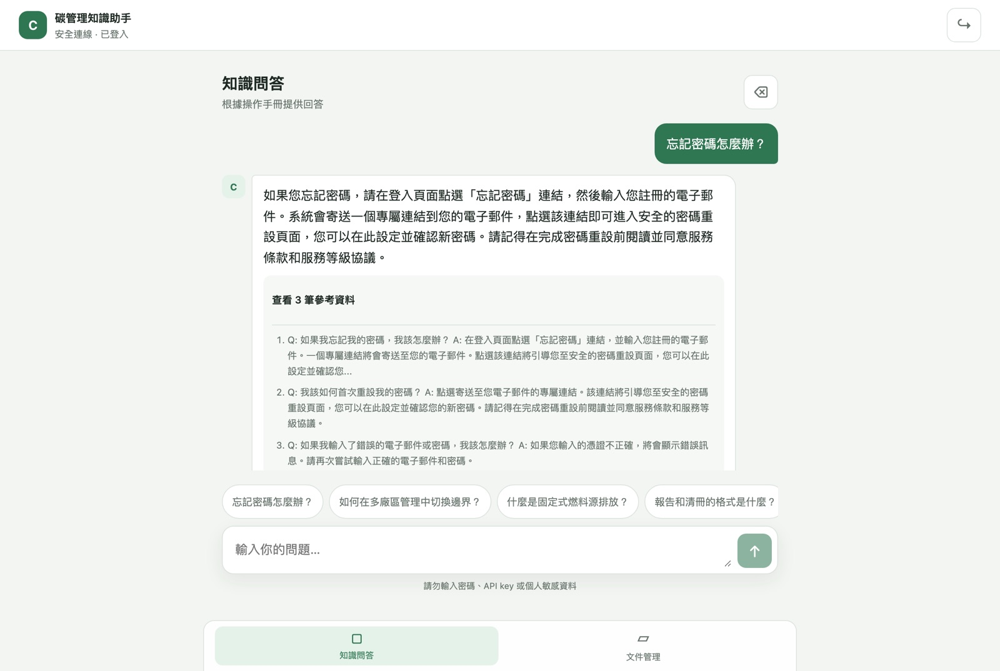
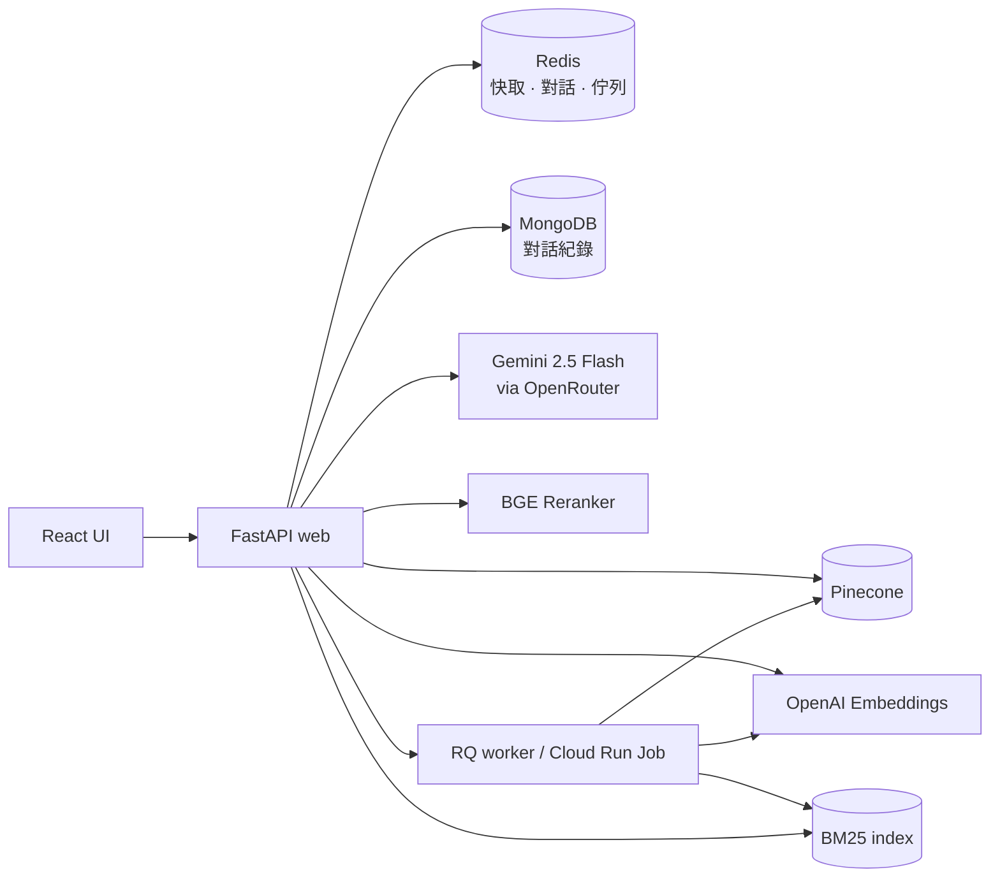

# RAG_DEMO

[](https://github.com/albertkingdom/rag-chatbot-demo/actions/workflows/ci.yml)

以碳管理系統（CarbonM）操作手冊為知識庫的 Agentic RAG 聊天機器人，兼具知識庫問答與通用問答。FastAPI 後端、React + TypeScript 手機優先介面，以 Docker Compose 在本機啟動，並部署於 Google Cloud Run。

> An agentic RAG chatbot over a product manual: hybrid BM25 + vector retrieval with reranking, self-corrective retry, semantic caching, two-way guardrails, and a streaming React UI. FastAPI backend, deployed on Cloud Run.



## 特色

- **混合路由**：規則層零延遲判斷明確查詢，僅不確定的查詢交給 LLM 決定走 RAG 或直接生成，並同時改寫追問。規則層可直接判定範例手冊 60 題中的 43 題，其餘由 LLM 路由，評估腳本會實際檢查全部判給知識庫。
- **Hybrid Search**：BM25 關鍵字檢索 + Pinecone 向量檢索，以 RRF 融合後由 BGE Reranker 精排。
- **自省式檢索**：重排分數不足時自動改寫查詢並重試（保留較佳結果）；仍不足時答案會標示「知識庫查無直接相關資料」、不顯示來源，也不寫入語意快取。
- **語意快取**：Redis 攔截相似問題，降低延遲與 token 成本。
- **雙端 Guardrail**：輸入端偵測 prompt injection，輸出端掃描 PII 與注入內容。
- **多輪對話**：保留短期對話脈絡，支援自然追問，可一鍵清除目前對話。
- **Typed NDJSON 串流**：分開傳送狀態、回答、來源與耗時。
- **背景知識庫同步**：上傳 PDF / XLSX / CSV，由背景任務增量同步向量庫與 BM25 索引，介面可查詢工作狀態。
- **範例知識庫**：附自製的虛構操作手冊，可直接上傳建立知識庫；同步與 RAGAS 評估使用獨立的 demo index。
- **可觀測性與評估**：LangSmith 追蹤各階段、MongoDB 保存對話紀錄、RAGAS 離線評估（faithfulness 1.0、answer relevancy 0.95、context precision 0.94、context recall 1.0；題庫 12 題，僅供參考）。
- **手機優先 React 介面**：登入、串流聊天、來源展開、文件上傳與深色模式。

## 系統架構



技術棧：FastAPI、LangChain、Pinecone、Redis（RQ）、MongoDB、React + TypeScript + Vite、Docker Compose、Terraform、Cloud Run。

請求流程、各階段參數、知識庫同步、評估方式與已知問題詳見 **[architecture.md](architecture.md)**。

## 快速開始

需要 Docker / Docker Compose，以及 OpenAI（embeddings）、Pinecone（向量庫）、OpenRouter（LLM）三組 API key（皆為付費服務）。

1. 在根目錄建立 `.env`（完整項目見 `.env.example`）：

   ```
   OPENAI_API_KEY="your_openai_api_key_here"
   PINECONE_API_KEY="your_pinecone_api_key_here"
   OPENROUTER_API_KEY="your_openrouter_api_key_here"

   APP_API_KEY="a_long_random_string_you_choose"   # 共用登入金鑰，用於 /login 及 X-API-Key
   AUTH_ENABLED=true                               # 本機開發/測試可設為 false
   ```

2. 啟動：

   ```bash
   docker compose up --build
   ```

3. 開啟：
   - 主應用程式：<http://localhost:8000>，輸入 `APP_API_KEY` 登入。
   - RedisInsight：<http://localhost:8001>（檢視 prompt cache）。
   - Mongo Express：<http://localhost:8081>（檢視對話紀錄）。

4. 建立知識庫：在「文件管理」上傳 `examples/carbonm_sample_manual.xlsx`（自行撰寫的虛構範例手冊，60 題），等同步工作顯示成功後即可提問；也可以上傳自己的 PDF / XLSX / CSV 手冊。首次同步會自動建立 Pinecone index `rag-demo-qa-index`（可用 `PINECONE_INDEX_NAME` 改名）。同步會刪除 index 中不在已上傳手冊裡的向量，請勿指向其他環境使用的 index。舊版本機環境的遷移方式見 [architecture.md](architecture.md#pinecone-index-與範例手冊)。

Compose 服務包含 `web`（FastAPI，提供 `/api/v1/*` 與 React 靜態成品）、`worker`（RQ 背景任務）、`redis`、`mongodb` 與上述兩個管理介面。前端獨立開發、測試與驗收腳本見 [docs/development.md](docs/development.md)。

## API

- `GET /api/v1/auth/session`、`POST /api/v1/auth/login`、`POST /api/v1/auth/logout`：session bootstrap、登入與撤銷。
- `POST /api/v1/chat/stream`：`application/x-ndjson` 串流事件。
- `GET|DELETE /api/v1/conversations/current/messages`：目前 session 的短期對話。
- `POST /api/v1/admin/manuals`、`GET /api/v1/admin/jobs/{job_id}`：上傳手冊與查詢同步狀態。

## 限制

這是 side project，以下為刻意的範圍取捨：

- 使用單一共用 `APP_API_KEY`，沒有多帳號與 RBAC；所有登入者皆可上傳文件。
- 部署維持單一 Cloud Run instance，未做壓測與背壓設計，冷啟動期間的並行請求可能被拒。
- 「停止」只停止瀏覽器接收，不保證取消後端模型工作與計費。
- 上傳僅做副檔名、MIME、大小與路徑的基本驗證，不含惡意檔案掃描。
- 輸出防護預設只放行 `example.com` 網域的 email（範例手冊的客服信箱），其他 email 的答案會被整段攔截；換成自己的知識庫時，以環境變數 `GUARDRAIL_ALLOWED_EMAIL_DOMAINS` 設定逗號分隔的網域（例如 `support.example.org,example.com`），設為空字串則所有 email 都攔截。docker compose 與 Terraform（`guardrail_allowed_email_domains`）都會把這個設定帶進容器。

細節見 [docs/development.md](docs/development.md#使用範圍細節)。

## 部署

`release/**` 分支 push 後，GitHub Actions 建置 image，並以 Terraform 更新 Cloud Run web Service 與 sync Job。正式環境使用 `JOB_RUNNER=gcp`，web 與 sync job 共用 GCS 掛載的 `DATA_SOURCE_DIR` / `BM25_INDEX_DIR`；`GCP_PROJECT_ID`、`GCP_REGION`、`SYNC_JOB_NAME` 指定背景 job。正式部署必須設定共用登入 key；HttpOnly session cookie 在 HTTPS 下使用 Secure，變更 API 使用同源 Origin/Referer 驗證。

發布流程與每版紀錄見 [docs/deployment/releases.md](docs/deployment/releases.md)。其他環境變數與預設值見 `.env.example`。

## 授權

[MIT](LICENSE)。範例手冊與評估資料為自行撰寫的虛構內容。
