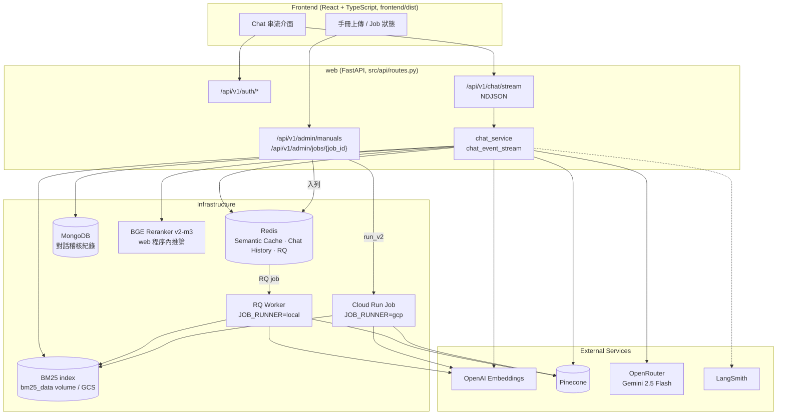
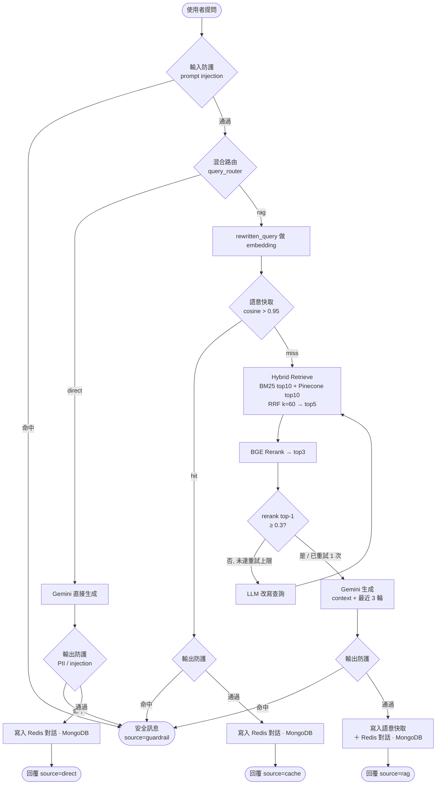
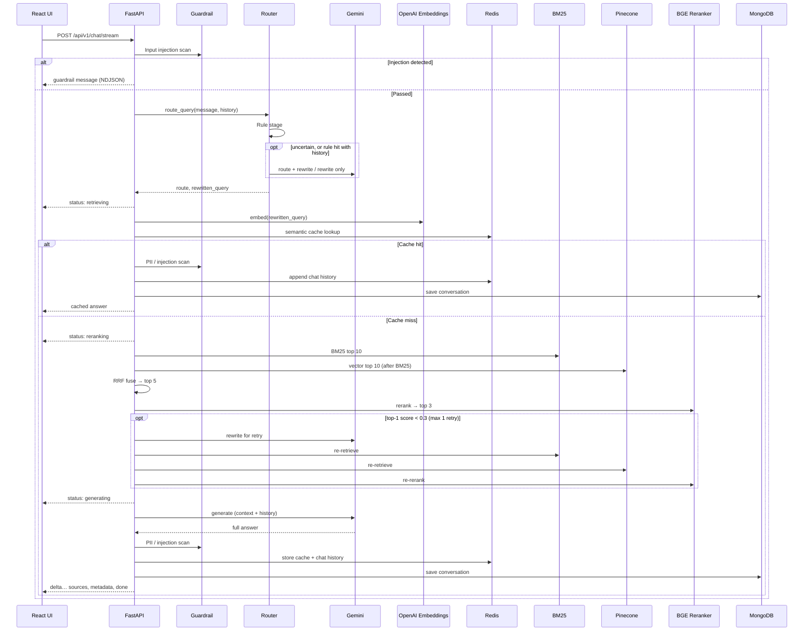
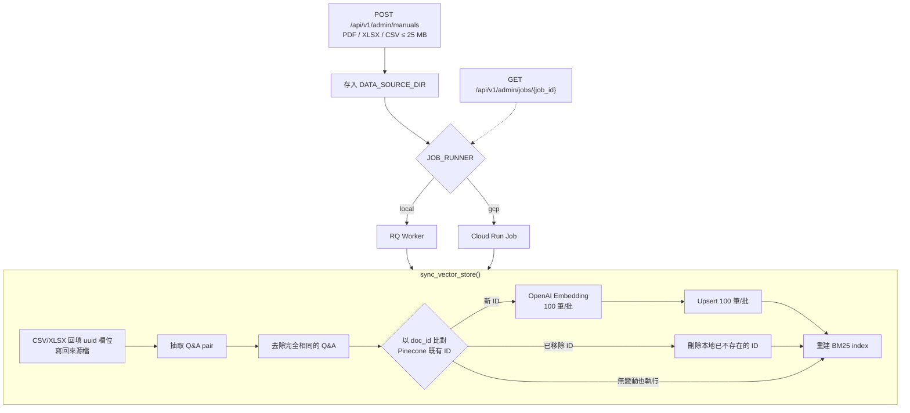

# RAG_DEMO - RAG Architecture

## System Overview

部署：本機以 Docker Compose 啟動 `web`、`worker`、`redis`、`mongodb`、`mongo-express`、`redis-insight`；正式環境為單一 Cloud Run service（React SPA 與 API 同源），背景同步改由 Cloud Run Job 執行，`DATA_SOURCE_DIR` / `BM25_INDEX_DIR` 以 GCS 掛載共用，基礎設施由 `terraform/` 管理。

## Chat 請求流程（`src/chat_service.py`）

所有路徑都會寫入 MongoDB（guardrail 擋下的也會，並附上命中的 PII 類型或 injection pattern）；direct、cache、rag 三條正常回覆路徑都會把這一輪寫入 Redis 短期對話；只有 rag 路徑會寫入語意快取。

### 0. 輸入防護（`guardrails.py`）
以 regex 掃描 prompt injection（中英文規則，例如「ignore previous instructions」、「系統提示」、「繞過」）。命中即回覆統一安全訊息，並以 `response_source="guardrail"` 寫入 MongoDB，不呼叫任何 LLM。

### 1. 混合路由與查詢改寫（`query_router.py`）
- **Stage 1 規則層（零延遲）**：先比對碳管理領域關鍵字（碳、ESG、溫室氣體、scope 1/2/3…）→ `rag`；再比對一般問答模式（招呼、感謝、簡單算式、翻譯、寫程式、笑話）→ `direct`；其餘為 `uncertain`。領域關鍵字優先，避免同時符合兩者的查詢被誤判為 direct。
- **規則命中且有對話歷史**：只呼叫 LLM 做查詢改寫（`_rewrite_only`），把追問（如「4.2 呢？」）改寫成獨立問題。
- **Stage 2 LLM 層**：`uncertain` 的查詢交由 Gemini 2.5 Flash，以 Pydantic 結構化輸出（`RouterResult`）一次回傳 `route`、`rewritten_query`、`reasoning`。
- **錯誤處理**：LLM 路由失敗時回退為 `direct`（不查知識庫）；`_rewrite_only` 失敗時沿用原始問題。
- 規則命中 `direct` 且有對話歷史時，仍會呼叫一次 `_rewrite_only`，但 direct 路徑生成時使用原始問題，該改寫結果不會被用到。
- 這層取代了舊的 intent classifier（舊版只能擋離題問題，不會分流到直接生成）。

### 2. Direct 路徑
不檢索、不查語意快取，直接以 QA prompt 生成（context 為空），生成後同樣經過輸出防護。

### 3. 語意快取（`cache_service.py`）
以改寫後的查詢做 OpenAI embedding，從 Redis set（`smembers`）取出快取 key 後只檢查其中 `CACHE_MAX_SEARCH_RESULTS`（5）筆，在 Python 中計算 cosine similarity，**> 0.95** 視為命中（TTL 24 小時）。命中的答案仍須通過 PII / injection 檢查才回傳；寫入時以同一個 embedding 為 key。

> ⚠️ Redis set 沒有順序，快取超過 5 筆後，被檢查的 5 筆等同任意挑選，是否命中帶有隨機性。見[已知問題](#已知問題)。

### 4. 混合檢索（`hybrid_retriever.py`）
- **BM25**：in-process `rank_bm25`，取前 `BM25_TOP_N`（10）筆。每次查詢前呼叫 `reload_if_stale()`，pointer 檔指向新版本時就重新載入，因此同步完成後 web 不需重啟即可使用新索引。索引不存在、為空或出錯時，自動降級為 `vector_only`。
- **向量檢索**：Pinecone，以非同步 `asimilarity_search_with_score` 取前 `VECTOR_TOP_N`（10）筆（不支援時才 fallback 為 `asyncio.to_thread`）。呼叫以 lock 序列化。
- **執行順序**：BM25（同步、in-process）先跑完，再 await 向量檢索，兩者**不是並行**。
- **RRF 融合**：以 Reciprocal Rank Fusion（`RRF_K=60`）合併兩路排名，取前 `FUSION_TOP_M`（5）筆（由 10 減半以縮短重排時間）。
- BM25 與向量結果、融合分數、fallback 原因記錄於 `fusion_metadata`，供 LangSmith 追蹤。

### 5. 重排（`rerank_stage.py`、`rag_pipeline.py`）
`BAAI/bge-reranker-v2-m3` cross-encoder 在 web 程序內對 query–doc 成對評分，取 Top 3（`RERANK_TOP_K`）。`rag_pipeline.py` 以 `asyncio.to_thread` 呼叫，避免阻塞 event loop。

### 6. 自省式檢索（`retrieval_grader.py`）
以 reranker top-1 分數判斷檢索品質，低於 `GRADE_SCORE_THRESHOLD`（0.3）時，由 LLM 參考低品質結果改寫查詢並重跑檢索與重排，最多 `RETRIEVAL_MAX_RETRIES`（1）次。直接沿用重排分數，不額外呼叫 LLM 評分。

### 7. 生成（`rag_pipeline.py`）
Gemini 2.5 Flash（OpenRouter，temperature 0）。Prompt 包含今天日期（台灣時區）、最近 3 輪對話（`format_history` 預設 `max_turns=3`）、Top 3 context，並要求以繁體中文回答；context 不相關時可改用一般知識回答。檢索使用改寫後的查詢，生成時則以原始問題搭配對話歷史。

### 8. 輸出防護與回應（`guardrails.py`、`chat_events.py`）
完整答案生成後，先做 PII（email、電話、信用卡、身分證字號、IP）與 injection 掃描（電話只比對台灣手機、台灣市話與 `+` 開頭的國際格式，不會誤判日期或一般數字），通過後才以 typed NDJSON 事件分段送出：

| 事件 | 內容 |
|------|------|
| `status` | 只在 rag 路徑送出：`retrieving`（embedding 與查快取之前）、`reranking`（混合檢索、重排與重試之前）、`generating`（生成之前）。direct 路徑不送 status |
| `delta` | 答案分段文字 |
| `sources` | 檢索來源摘要 |
| `metadata` | `elapsedMs`、`responseSource`（rag / direct / cache / guardrail）、`cacheHit` |
| `done` / `error` | 結束或錯誤 |

Redis 短期對話以 `CHAT_HISTORY_TTL_SECONDS` 控制（預設閒置 30 分鐘過期），保留 `CHAT_HISTORY_MAX_TURNS` 輪。

## Sequence Diagram（RAG 路徑）

## Document Ingestion（`build_vector_store.py`、`manual_service.py`）

- `doc_id` 取自來源檔的 `uuid` 欄位；CSV/XLSX 缺 uuid 時會產生並寫回原檔，寫回失敗則中止同步，避免以不穩定的 ID upsert。PDF 沒有 uuid 欄位，每次同步都會在記憶體中產生新的 ID。
- 差異比對**只看 ID**：新的 ID 會 upsert，已不在本地的 ID 會刪除。若同一個 uuid 的問答內容被修改，不會被重新 embedding。
- **PDF 每次同步都會全量重做**：PDF 的 ID 每次重新產生，所以既有 PDF 向量全部被刪除、再重新 embedding 與 upsert。
- 若 Pinecone `list()` 失敗，視為索引為空：所有文件重新 upsert，且不刪除任何向量。
- 無論有無差異，每次同步都會用完整的本地文件重建 BM25 index；重建失敗不影響已完成的向量同步。
- web 端在每次 BM25 查詢前檢查 pointer 檔，同步完成後的下一個查詢就會載入新索引。

## Key Parameters

| Component | Parameter | Value | 定義位置 |
|-----------|-----------|-------|----------|
| Vector Retrieval | `VECTOR_TOP_N` | 10 | `config.py` |
| BM25 Retrieval | `BM25_TOP_N` | 10 | `config.py` |
| Fusion | `RRF_K` | 60 | `config.py` |
| Fusion | `FUSION_TOP_M` | 5 | `config.py` |
| Reranking | `RERANK_TOP_K` | 3 | `rerank_stage.py` |
| Retrieval Grader | `GRADE_SCORE_THRESHOLD` | 0.3 | `config.py`（env 可覆寫） |
| Retrieval Grader | `RETRIEVAL_MAX_RETRIES` | 1 | `config.py`（env 可覆寫） |
| Semantic Cache | `CACHE_SIMILARITY_THRESHOLD` / `CACHE_TTL_SECONDS` | 0.95（嚴格大於）/ 24 hours | `config.py` |
| Semantic Cache | `CACHE_MAX_SEARCH_RESULTS` | 5 | `config.py` |
| Chat History | `CHAT_HISTORY_MAX_TURNS` / `CHAT_HISTORY_TTL_SECONDS` | 3 / 30 minutes | `config.py`（env 可覆寫） |
| Prompt History | `max_turns` | 3 | `rag_pipeline.py`（`format_history` 預設值） |
| Embedding | Dimensions / batch | 1536 / 100 docs per call | `build_vector_store.py` |
| Vector Upsert | Batch Size | 100 vectors | `build_vector_store.py` |
| LLM | Model / temperature | `google/gemini-2.5-flash` / 0 | `services.py` |
| Access | `RATE_LIMIT_RPM` | 60 | `config.py`（env 可覆寫） |

## Evaluation

- `tests/generate_rag_eval_data.py`：從知識庫抽樣 Q&A，由 LLM 把問題改寫成口語問法，原答案作為 `ground_truth`，輸出到 draft 檔，經人工審核後才升為 `tests/rag_eval_data.json`。
- `tests/evaluate_rag.py`：用 golden set 直接呼叫檢索 chain（hybrid + rerank）與生成 chain，不經過路由、語意快取、自省重試與 guardrail，也不帶對話歷史；以 RAGAS 評估 faithfulness、answer_relevancy、context_precision、context_recall，judge 沿用專案的 Gemini 與 OpenAI embeddings。報告寫入 `tests/rag_eval_report.json`；任一指標低於門檻（預設 0.7，可用 `RAG_EVAL_MIN_<METRIC>` 覆寫）時 exit code 為 1。
- `tests/evaluate_rerank.py`：評估重排效果。
- 目前 `tests/rag_eval_report.json` 產生於 2026-06-27，早於 prompt 加入 `{today}` 變數（2026-08-21）與之後的路由、檢索調整，需要重新執行評估才能反映現況。

## Performance Optimizations

| 優化 | 位置 | 效果 |
|------|------|------|
| Embedding 改批次（100 筆/次） | `build_vector_store.py` | API 呼叫數約減少 100 倍，同步時間明顯縮短（見下方估計） |
| Rerank 改 `asyncio.to_thread` | `rag_pipeline.py` | cross-encoder 推論不再阻塞 event loop |
| Fusion 候選 10 → 5 | `config.py` | 重排推論量減半 |
| 規則路由 | `query_router.py` | 明確查詢不需呼叫 LLM |
| 語意快取 | `cache_service.py` | 相似問題跳過整條 RAG |
| 答案分段 yield | `chat_service.py` | 以固定大小分段串流 NDJSON `delta` |

批次 embedding 前後的同步時間**粗略估計**（未保留量測腳本與環境紀錄，僅供參考）：

| Documents | Before | After | Speedup |
|-----------|--------|-------|---------|
| 50 | ~20s | ~3s | 6x |
| 200 | ~90s | ~8s | 11x |
| 1000 | ~7min | ~25s | 16x |

## 已知問題

| 問題 | 位置 | 影響 |
|------|------|------|
| 語意快取只檢查任意 5 筆 | `cache_service.py`：`list(smembers(...))[:5]` | 快取超過 5 筆後命中帶有隨機性 |
