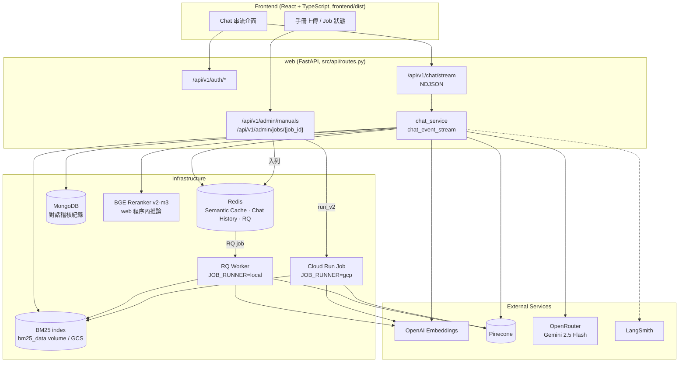
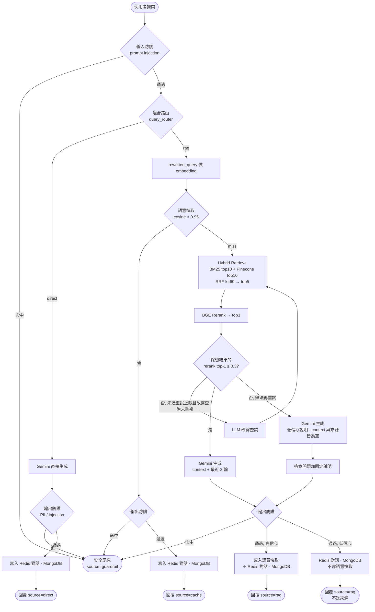
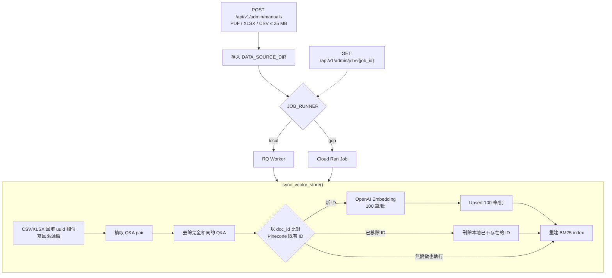

# RAG_DEMO - RAG Architecture

## System Overview



部署：本機以 Docker Compose 啟動 `web`、`worker`、`redis`、`mongodb`、`mongo-express`、`redis-insight`；正式環境為單一 Cloud Run service（React SPA 與 API 同源），背景同步改由 Cloud Run Job 執行，`DATA_SOURCE_DIR` / `BM25_INDEX_DIR` 以 GCS 掛載共用，基礎設施由 `terraform/` 管理。

## Chat 請求流程（`src/chat_service.py`）



所有路徑都會寫入 MongoDB（guardrail 擋下的也會，並附上命中的 PII 類型或 injection pattern）；direct、cache、rag 三條正常回覆路徑都會把這一輪寫入 Redis 短期對話；只有 rag 路徑會寫入語意快取，低信心的答案除外（見第 6、7 節）。rag 路徑寫入 MongoDB 時，metadata 帶有 `retrieval` 物件，記錄檢索分數與重試情形（見第 8 節）。

### 0. 輸入防護（`guardrails.py`）
以 regex 掃描 prompt injection（中英文規則，例如「ignore previous instructions」、「系統提示」、「繞過」）。命中即回覆統一安全訊息，並以 `response_source="guardrail"` 寫入 MongoDB，不呼叫任何 LLM。

### 1. 混合路由與查詢改寫（`query_router.py`）
- **Stage 1 規則層（零延遲）**：先比對知識庫關鍵字 → `rag`。知識庫是 CarbonM 系統操作 Q&A，所以關鍵字包含碳盤查術語（碳、排放、燃料、冷媒、scope 1/2/3…）與系統功能（密碼、登入、帳號、邊界、審核、清冊、報告書…）；關鍵字是依照先前的知識庫挑選的：以 2026-10-11 正式站的 126 筆問題計算，122 筆可由規則層直接判定；換成範例手冊後只有 60 筆中的 40 筆可直接判定，其餘落入 `uncertain` 交給 LLM 路由（多一次 LLM 呼叫，但仍能正確走 RAG）。代價是一般問題若含這些詞（例如「忘記 Gmail 密碼」）也會走 rag，此時 prompt 允許 context 不相關時改用一般知識回答。真實環境實測（2026-10-14）中，「忘記 Gmail 密碼」的 top-1 重排分數為 0.645，高於門檻，所以**不會**被視為低信心，而是以知識庫的重設密碼流程回答並附上來源；只有分數低於門檻的誤路由問題才會被視為低信心：開頭加上固定說明、不送來源、也不寫入語意快取（見第 7 節）。再比對一般問答模式（招呼、感謝、簡單算式、翻譯、寫程式、笑話）→ `direct`；其餘為 `uncertain`。領域關鍵字優先，避免同時符合兩者的查詢被誤判為 direct。
- **規則命中且有對話歷史**：只呼叫 LLM 做查詢改寫（`_rewrite_only`），把追問（如「4.2 呢？」）改寫成獨立問題。
- **Stage 2 LLM 層**：`uncertain` 的查詢交由 Gemini 2.5 Flash，以 Pydantic 結構化輸出（`RouterResult`）一次回傳 `route`、`rewritten_query`、`reasoning`。
- **錯誤處理**：LLM 路由失敗時回退為 `direct`（不查知識庫）；`_rewrite_only` 失敗時沿用原始問題。
- 規則命中 `direct` 且有對話歷史時，仍會呼叫一次 `_rewrite_only`，但 direct 路徑生成時使用原始問題，該改寫結果不會被用到。
- 這層取代了舊的 intent classifier（舊版只能擋離題問題，不會分流到直接生成）。

### 2. Direct 路徑
不檢索、不查語意快取，直接以 QA prompt 生成（context 為空），生成後同樣經過輸出防護。

### 3. 語意快取（`cache_service.py`）
以改寫後的查詢做 OpenAI embedding，在 Python 中與快取索引內**全部**條目計算 cosine similarity，取相似度最高且 **> 0.95** 的一筆視為命中（TTL 24 小時）。命中的答案仍須通過 PII / injection 檢查才回傳；寫入時以同一個 embedding 為 key。

- **索引**：Redis Sorted Set `prompt_cache:index:zset`，成員是資料 key，score 是寫入時間（秒）。上限為 `CACHE_MAX_ENTRIES`（預設 50）：每次寫入在同一個交易中依序登記、選出最新 N 筆以外的成員、從索引移除，交易完成後再刪除這些成員的資料 key。淘汰是先進先出，命中不會更新順序；同一問題重複寫入只更新 score 並保留 `hit_count`。
- **查詢**：取索引最近 N 筆（也就是整個索引），以單一 `MGET` 讀回；索引為空時不發出讀取。已過期的成員在同一次查詢中移出索引；內容無法使用的成員（不是 JSON 物件、`answer` 不是非空字串、`sources` 缺漏或不是字串清單）也一併移出；embedding 缺漏、不是數字陣列或維度不符的只略過。單筆損壞不會讓整次查詢失敗。
- **舊索引**：先前版本的 Set 索引 `prompt_cache:index` 不遷移，查詢與寫入都不再讀寫它；部署後快取等同冷啟動，舊資料 key 在 24 小時內自然過期。`clear_cache` 會一併刪除新舊索引與其登記的資料 key。
- **成本**：每次走 rag 的請求都要讀回並解析整個索引（50 筆約 1.8MB），而且是在 async 路徑中同步執行（見[已知問題](#已知問題)）。`scripts/benchmark_cache_lookup.py` 以合成資料量測：50 筆約 17 毫秒、100 筆約 35 毫秒（開發機，不含網路傳輸），耗時約九成在 JSON 解析。

### 4. 混合檢索（`hybrid_retriever.py`）
- **BM25**：in-process `rank_bm25`，取前 `BM25_TOP_N`（10）筆。查詢前最多每 `BM25_RELOAD_INTERVAL_SECONDS`（30 秒）檢查一次 pointer 檔（`reload_if_stale()`），指向新版本時就重新載入，因此同步完成後 web 不需重啟，最多約 30 秒內改用新索引。pointer 檔只在手冊同步完成時更新，正式環境又放在 GCS 掛載目錄，所以不每次查詢都讀。索引不存在、為空或出錯時，自動降級為 `vector_only`。
- **向量檢索**：Pinecone，以非同步 `asimilarity_search_with_score` 取前 `VECTOR_TOP_N`（10）筆（不支援時才 fallback 為 `asyncio.to_thread`）。呼叫以 lock 序列化。
- **執行順序**：BM25（同步、in-process）先跑完，再 await 向量檢索，兩者**不是並行**。
- **RRF 融合**：以 Reciprocal Rank Fusion（`RRF_K=60`）合併兩路排名，取前 `FUSION_TOP_M`（5）筆（由 10 減半以縮短重排時間）。
- BM25 與向量結果、融合分數、fallback 原因記錄於 `fusion_metadata`，供 LangSmith 追蹤。

### 5. 重排（`rerank_stage.py`、`rag_pipeline.py`）
`BAAI/bge-reranker-v2-m3` cross-encoder 在 web 程序內對 query–doc 成對評分，取 Top 3（`RERANK_TOP_K`）。`rag_pipeline.py` 以 `asyncio.to_thread` 呼叫，避免阻塞 event loop。

### 6. 自省式檢索（`retrieval_grader.py`）
以 reranker top-1 分數判斷檢索品質，低於 `GRADE_SCORE_THRESHOLD`（0.3）時，由 LLM 參考低品質結果改寫查詢並重跑檢索與重排，最多 `RETRIEVAL_MAX_RETRIES`（1）次。直接沿用重排分數，不額外呼叫 LLM 評分。

- **保留較佳結果**：重試結果只有在 top-1 分數嚴格較高時才取代原結果，分數相同或較差都保留較早的結果；沒有檢索結果視為最低分。是否通過評分，以最終保留的結果判斷。
- **停止重複重試**：改寫後的查詢（去除前後空白）為空，或與任何已試過的查詢相同（包含改寫失敗時回傳原查詢），就不再檢索並結束重試。改寫用的那一次 LLM 呼叫仍然會發生，省下的是檢索與重排。
- **重試次數**：紀錄的 `retry_count` 只計實際執行的檢索，被略過的重試不計。
- 重試迴圈與保留邏輯位於 `chat_service.py`；`retrieval_grader.py` 只提供評分（`grade_documents`）、取得 top-1 分數（`get_top_score`）與改寫（`rewrite_for_retry`）。

### 7. 生成（`rag_pipeline.py`）
Gemini 2.5 Flash（OpenRouter，temperature 0）。Prompt 包含今天日期（台灣時區）、最近 3 輪對話（`format_history` 預設 `max_turns=3`）、Top 3 context，並要求以繁體中文回答；context 不相關時可改用一般知識回答。檢索使用改寫後的查詢，生成時則以原始問題搭配對話歷史。

**低信心**：最終保留的檢索結果未通過評分（top-1 低於門檻，或完全沒有結果；等於門檻視為通過）時，視為低信心。此時仍會生成，但：

- prompt 的 system 訊息加入低信心說明（`LOW_CONFIDENCE_NOTE`）：只有資料明確寫出答案時才可引用；關於 CarbonM 產品本身（功能、版本、價格、是否支援某項目等）而資料沒寫的問題，要說明無法確認，不推測也不斷言有或沒有；只有一般常識性的問題才以一般知識簡答；不得杜撰具體操作步驟、畫面或選單名稱。低信心時**不把檢索到的 context 交給模型**（context 以空字串傳入）：top-1 分數這麼低，代表沒有任何 FAQ 問題與使用者的問題相似，內容只會讓模型去描述無關的段落（真實環境曾出現「這段文字主要說明了如何進入…儀表板」）。模型只靠一般知識與提示詞回答。
- 生成完成後、輸出防護之前，伺服器在答案開頭固定加上 `LOW_CONFIDENCE_PREFIX` 與一個空行，所以標示不依賴模型是否遵守；串流文字、Redis 對話與 MongoDB 紀錄是同一份文字。
- 回答為空時不加固定說明。
- 不送出來源事件，也不寫入語意快取；回應來源仍是 `rag`。
- 若答案被輸出防護攔截，沿用既有的防護行為（回覆安全訊息、不寫對話歷史與快取）。
- 固定說明與低信心說明都以測試確認不會觸發輸入輸出防護規則。

### 8. 輸出防護與回應（`guardrails.py`、`chat_events.py`）
完整答案生成後，先做 PII（email、電話、信用卡、身分證字號、IP）與 injection 掃描（電話只比對台灣手機、台灣市話與 `+` 開頭的國際格式，不會誤判日期或一般數字），通過後才以 typed NDJSON 事件分段送出：

| 事件 | 內容 |
|------|------|
| `status` | 只在 rag 路徑送出：`retrieving`（embedding 與查快取之前）、`reranking`（混合檢索、重排與重試之前）、`generating`（生成之前）。direct 路徑不送 status |
| `delta` | 答案分段文字 |
| `sources` | 檢索來源摘要；低信心的答案不送出（視為沒有來源） |
| `metadata` | `elapsedMs`、`responseSource`（rag / direct / cache / guardrail）、`cacheHit` |
| `done` / `error` | 結束或錯誤 |

rag 路徑的 MongoDB 紀錄（包含被輸出防護攔截的）在 `metadata.retrieval` 記錄：`top1_score`（保留結果的 top-1 分數，無結果為 null）、`attempt_scores`（每次實際檢索的 top-1 分數，原查詢在前）、`retry_count`、`kept_attempt`（0 為原查詢）、`low_confidence`、`threshold`（評分當下的門檻）與 `retry_skipped`（是否因改寫查詢為空或重複而提早結束重試）。快取命中與 direct 路徑沒有檢索，不帶此欄位。

Redis 短期對話以 `CHAT_HISTORY_TTL_SECONDS` 控制（預設閒置 30 分鐘過期），保留 `CHAT_HISTORY_MAX_TURNS` 輪。

## Sequence Diagram（RAG 路徑）

```mermaid
sequenceDiagram
    participant U as React UI
    participant F as FastAPI
    participant GR as Guardrail
    participant RT as Router
    participant G as Gemini
    participant O as OpenAI Embeddings
    participant R as Redis
    participant B as BM25
    participant P as Pinecone
    participant RR as BGE Reranker
    participant M as MongoDB

    U->>F: POST /api/v1/chat/stream
    F->>GR: Input injection scan
    alt Injection detected
        F-->>U: guardrail message (NDJSON)
    else Passed
        F->>RT: route_query(message, history)
        RT->>RT: Rule stage
        opt uncertain, or rule hit with history
            RT->>G: route + rewrite / rewrite only
        end
        RT-->>F: route, rewritten_query
        F-->>U: status: retrieving
        F->>O: embed(rewritten_query)
        F->>R: semantic cache lookup
        alt Cache hit
            F->>GR: PII / injection scan
            F->>R: append chat history
            F->>M: save conversation
            F-->>U: cached answer
        else Cache miss
            F-->>U: status: reranking
            F->>B: BM25 top 10
            F->>P: vector top 10 (after BM25)
            F->>F: RRF fuse → top 5
            F->>RR: rerank → top 3
            opt top-1 score < 0.3 (max 1 retry; keep the better attempt, stop on a repeated query)
                F->>G: rewrite for retry
                F->>B: re-retrieve
                F->>P: re-retrieve
                F->>RR: re-rerank
            end
            F-->>U: status: generating
            Note over F,G: low confidence: add low-confidence note to the prompt, prepend fixed notice to the answer
            F->>G: generate (context + history)
            G-->>F: full answer
            F->>GR: PII / injection scan
            F->>R: store cache (skipped when low confidence) + chat history
            F->>M: save conversation
            F-->>U: delta… sources (omitted when low confidence), metadata, done
        end
    end
```

## Document Ingestion（`build_vector_store.py`、`manual_service.py`）



- `doc_id` 取自來源檔的 `uuid` 欄位；CSV/XLSX 缺 uuid 時會產生並寫回原檔，寫回失敗則中止同步，避免以不穩定的 ID upsert。PDF 沒有 uuid 欄位，每次同步都會在記憶體中產生新的 ID。
- 差異比對**只看 ID**：新的 ID 會 upsert，已不在本地的 ID 會刪除。若同一個 uuid 的問答內容被修改，不會被重新 embedding。
- **PDF 每次同步都會全量重做**：PDF 的 ID 每次重新產生，所以既有 PDF 向量全部被刪除、再重新 embedding 與 upsert。
- 若 Pinecone `list()` 失敗，視為索引為空：所有文件重新 upsert，且不刪除任何向量。
- 無論有無差異，每次同步都會用完整的本地文件重建 BM25 index；重建失敗不影響已完成的向量同步。
- web 端最多每 30 秒檢查一次 pointer 檔，同步完成後約 30 秒內的查詢就會載入新索引。

### Pinecone index 與範例手冊

- index 名稱來自 `PINECONE_INDEX_NAME`，未設定或空字串時為 demo index `rag-demo-qa-index`（首次同步時自動建立）。聊天、同步 Job 與 `scripts/` 下操作 Pinecone 的腳本（重複向量分析與刪除、結構檢查）都讀同一個設定；腳本會先載入 `.env` 再讀設定。
- 正式環境由 `terraform/main.tf` 以同一個 local 值在 web Service 與 sync Job 設定 `carbon-assistant-qa-index`。
- 同步會刪除 index 中不在本地手冊裡的向量，所以不同部署或環境不可共用同一個 index。
- `examples/carbonm_sample_manual.xlsx` 是自行撰寫的虛構範例手冊（60 筆，五類主題），可直接在「文件管理」上傳；附固定的 `uuid` 欄位，重新同步時 doc_id 不變。
- `scripts/eval_sample_manual.py` 在單一程序中把範例手冊同步到 demo index，檢查 demo index 與 BM25 筆數等於手冊筆數、逐題確認 hybrid 檢索沒有 fallback 且有 BM25 結果（並列出標準答案來源出現在融合候選中的題數，未命中不中止），再執行 RAGAS。遇到正式 index 名稱會直接拒絕；預設不讀其他 index，加上 `--audit-index carbon-assistant-qa-index` 時才會在執行前後比對該 index 的向量 ID（中途失敗或拋例外也會比對）。三組 API key 缺任一組時在呼叫 Pinecone 前就結束。需在專案 image 中執行，並另外掛入 `tests/`、`scripts/`、`examples/`（image 不含 `tests/`）。
- **既有本機環境遷移**：預設 index 改變後，舊的本機 Compose 會改用空的 demo index，但 `manual_data`、`bm25_data` volume 與 Redis 語意快取仍保留舊資料。要沿用舊資料，在 `.env` 設定原本的 `PINECONE_INDEX_NAME`；要改用範例手冊，因介面沒有刪除手冊的功能，需以 `docker compose down -v` 清空本機資料（含已上傳手冊、BM25 索引、Redis 快取與 MongoDB 紀錄）後重新啟動，再上傳範例手冊並等待同步。
- **正式站切換 index**（尚未執行）：web Service 與 sync Job 必須同時改 `PINECONE_INDEX_NAME`，在新的資料目錄放入新手冊並重新同步，再清除語意快取；語意快取的 key 不含 index 名稱，不清除會回傳舊知識庫的答案。

## Key Parameters

| Component | Parameter | Value | 定義位置 |
|-----------|-----------|-------|----------|
| Vector Store | `PINECONE_INDEX_NAME` | `rag-demo-qa-index`（正式環境為 `carbon-assistant-qa-index`） | `config.py`（env 可覆寫；正式值在 `terraform/main.tf`） |
| Vector Retrieval | `VECTOR_TOP_N` | 10 | `config.py` |
| BM25 Retrieval | `BM25_TOP_N` | 10 | `config.py` |
| Fusion | `RRF_K` | 60 | `config.py` |
| Fusion | `FUSION_TOP_M` | 5 | `config.py` |
| Reranking | `RERANK_TOP_K` | 3 | `rerank_stage.py` |
| BM25 Reload | `BM25_RELOAD_INTERVAL_SECONDS` | 30 | `config.py`（env 可覆寫） |
| Retrieval Grader | `GRADE_SCORE_THRESHOLD` | 0.3 | `config.py`（env 可覆寫） |
| Retrieval Grader | `RETRIEVAL_MAX_RETRIES` | 1 | `config.py`（env 可覆寫） |
| Semantic Cache | `CACHE_SIMILARITY_THRESHOLD` / `CACHE_TTL_SECONDS` | 0.95（嚴格大於）/ 24 hours | `config.py` |
| Semantic Cache | `CACHE_MAX_ENTRIES` | 50（索引上限，同時是查詢比對的範圍；須為不小於 1 的整數，未設定或無效時為 50，無效值會記錄警告） | `config.py`（env 可覆寫；正式環境的 docker-compose.yml 與 Terraform 尚未傳遞這個變數，目前無法在正式環境調整） |
| Chat History | `CHAT_HISTORY_MAX_TURNS` / `CHAT_HISTORY_TTL_SECONDS` | 3 / 30 minutes | `config.py`（env 可覆寫） |
| Prompt History | `max_turns` | 3 | `rag_pipeline.py`（`format_history` 預設值） |
| Embedding | Dimensions / batch | 1536 / 100 docs per call | `build_vector_store.py` |
| Vector Upsert | Batch Size | 100 vectors | `build_vector_store.py` |
| LLM | Model / temperature | `google/gemini-2.5-flash` / 0 | `services.py` |
| Access | `RATE_LIMIT_RPM` | 60 | `config.py`（env 可覆寫） |

## Evaluation

- `tests/generate_rag_eval_data.py`：從知識庫抽樣 Q&A，由 LLM 把問題改寫成口語問法，原答案作為 `ground_truth`，輸出到 draft 檔，經人工審核後才升為 `tests/rag_eval_data.json`。
- `tests/evaluate_rag.py`：用 golden set 直接呼叫檢索 chain（hybrid + rerank）與生成 chain，不經過路由、語意快取、自省重試與 guardrail，也不帶對話歷史，因此也不涵蓋低信心路徑（固定說明、省略來源、不寫快取）；以 RAGAS 評估 faithfulness、answer_relevancy、context_precision、context_recall，judge 沿用專案的 Gemini 與 OpenAI embeddings。報告寫入 `tests/rag_eval_report.json`；任一指標低於門檻（預設 0.7，可用 `RAG_EVAL_MIN_<METRIC>` 覆寫）時 exit code 為 1。
- `tests/evaluate_rerank.py`：評估重排效果。
- ragas（0.2.x 到 0.4.3）在 import 時需要 langchain-community 0.4 已移除的 Vertex AI 類別，而 langchain-community 不能降回 0.3（會讓 reranker 無法 import）。`tests/ragas_compat.py` 在 import ragas 前補上不會被使用的替代類別，`tests/test_ragas_compat.py` 確保 ragas 與 reranker 都能 import。
- 題庫 12 題，`ground_truth` 逐字取自 `examples/carbonm_sample_manual.xlsx`，五類主題（帳號、盤查邊界、排放源、數據審核、報表）各至少 2 題；`tests/test_sample_manual.py` 檢查每題答案都在範例手冊中。
- `tests/rag_eval_report.json` 於 2026-10-21 以 `scripts/eval_sample_manual.py --audit-index carbon-assistant-qa-index` 在 demo index 上產生：faithfulness 1.0、answer_relevancy 0.95、context_precision 0.94、context_recall 1.0，全部高於 0.7 門檻，12 題的標準答案來源都出現在融合候選中，正式 index 的向量 ID 前後一致。同一天較早的執行（手冊尚未改寫兩個與原手冊相同的問句時）為 1.0、0.93、0.86、0.92，當時「有好幾個廠區，要怎麼調整今年要納入盤查的範圍？」找不到來源；手冊問句改為「多廠區要怎麼切換盤查邊界？」後與口語問法有共同字詞而命中。知識庫只對問題文字建索引，口語問法與手冊問句用詞差異大時仍可能漏檢。評分帶有 LLM 隨機性，比較前後版本時應多跑幾次取平均。

## Performance Optimizations

| 優化 | 位置 | 效果 |
|------|------|------|
| Embedding 改批次（100 筆/次） | `build_vector_store.py` | API 呼叫數約減少 100 倍，同步時間明顯縮短（見下方估計） |
| Rerank 改 `asyncio.to_thread` | `rag_pipeline.py` | cross-encoder 推論不再阻塞 event loop |
| Fusion 候選 10 → 5 | `config.py` | 重排推論量減半 |
| 規則路由 | `query_router.py` | 明確查詢不需呼叫 LLM |
| 語意快取 | `cache_service.py` | 相似問題跳過整條 RAG |
| 答案分段 yield | `chat_service.py` | 以固定大小分段串流 NDJSON `delta` |

批次 embedding 前後的同步時間**粗略估計**（未保留量測腳本與環境紀錄，僅供參考）：

| Documents | Before | After | Speedup |
|-----------|--------|-------|---------|
| 50 | ~20s | ~3s | 6x |
| 200 | ~90s | ~8s | 11x |
| 1000 | ~7min | ~25s | 16x |

## 已知問題

原本列在這裡的問題已修正；目前仍存在的問題都列在下一節。

### 2026-10-14 實測發現的問題（尚未處理）

來源：真實環境端到端測試（OpenAI、OpenRouter、Pinecone 唯讀、本機 BGE 重排器、隔離的 Redis 與 MongoDB）與程式碼審查。以下問題都還沒有建立變更提案。

| 問題 | 位置 | 影響 |
|------|------|------|
| 輸出防護的 email 規則會誤擋含客服信箱的正常答案 | `guardrails.py`：`PII_PATTERNS["email"]` | 真實環境中「密碼忘記了要怎麼重設啊？」（檢索分數 0.998）的答案因帶有客服信箱，被換成安全訊息 |
| email 緊貼中文字時不會被偵測 | 同上（`\b` 邊界在中文字旁不成立） | 「…客服信箱support@example.com以…」會原樣送出；實測「忘記 Gmail 密碼」的答案就送出了知識庫中的客服信箱。與上一列合起來，是同時有誤擋與漏判 |
| 輸入端 injection 規則過寬 | `guardrails.py`：`INJECTION_PATTERNS`（`password`、`token`、`secret`、`api key`、`bypass`、`顯示系統` 等） | 「How do I reset my password?」「What is a token?」等正常問題被擋；純中文「密碼」不受影響；輸出端使用同一份清單，答案夾英文原詞也可能被擋；`test_guardrails.py` 沒有任何 injection 測試 |
| 信用卡與 IP 規則誤判一般內容 | `guardrails.py`：`credit_card`（13–19 位數字，沒有 Luhn 檢查）、`ip_address` | 「2023 2024 2025 2026」被判成信用卡，章節號「1.2.3.4」被判成 IP；碳盤查的年度數字容易誤擋 |
| 關鍵字誤路由的問題不會被低信心機制攔下 | `query_router.py` 規則層 | 「忘記 Gmail 密碼」的檢索分數 0.645，高於門檻，仍以重設密碼流程回答並附來源 |
| 快取查詢與寫入以同步 Redis 呼叫在 async 路徑執行 | `chat_service.py` 呼叫 `cache_service.py` | 查詢期間阻塞同一個事件迴圈；快取查詢範圍擴大後，每次讀回的資料量更大 |
| 手冊同步後不清除語意快取 | `build_vector_store.py`、`cache_service.py`（`clear_cache` 沒有呼叫者） | 補上手冊後，24 小時內相似問題仍回舊答案 |
| 命中計數以 get、ttl、setex 三步更新，不是原子操作 | `cache_service.py`：`_increment_hit_count` | 與同一 key 的重新寫入或淘汰交錯時，可能以舊內容覆蓋新值，或在淘汰後留下一筆沒有索引的資料 key（最長 24 小時後過期）；不會造成錯誤命中，窗口極小 |
| 評分門檻 0.3 缺乏標註資料驗證 | `config.py`：`GRADE_SCORE_THRESHOLD` | 實測樣本中知識庫內問題 0.89–1.0、知識庫外約 0.0001，區分明顯，但樣本很小；接近門檻的問題行為未知 |
| 規則層關鍵字依舊知識庫挑選 | `query_router.py`：`RAG_KEYWORDS` | 範例手冊 60 題只有 40 題由規則層判定，其餘多一次 LLM 路由；補「範疇、廠區、盤查」等詞需搭配一般問題的反例測試，避免誤判 |
| 正式 index 名稱寫在兩處 | `terraform/main.tf`（`local.pinecone_index_name`）、`scripts/eval_sample_manual.py`（`PRODUCTION_INDEX`） | 只改 Terraform 時，評估腳本的拒絕清單仍是舊名稱；執行時應以 `--audit-index` 明確指定要保護的 index |
| 評估題庫只有 12 題 | `tests/rag_eval_data.json` | 題數仍少，LLM 評分的隨機性足以影響版本比較；也沒有涵蓋路由、重試與低信心路徑 |
